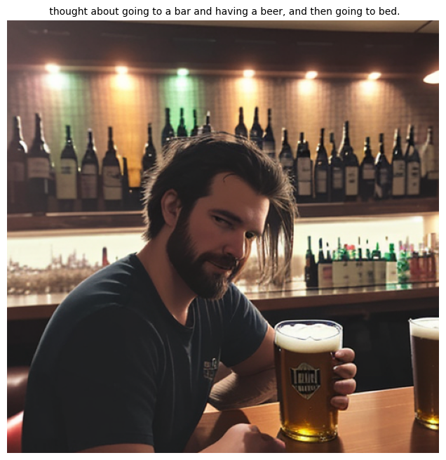

# Dream Recreation from EEG

> Can a model read sleep brainwaves and turn them into a picture of the dream?

An exploratory deep learning pipeline that goes **EEG → dream text → dream image**. It extracts spectral features from sleep EEG recordings, learns to map them to the dream reports participants gave on waking, and renders the generated text with a diffusion model.

Built as a group project for *Designing AI* (3rd year, BDBA, IE University).

<p align="center">
  
  <br>
  <em>Output of the full pipeline for one EEG sample. Script generated by the EEG-conditioned GPT-2: "thought about going to a bar and having a beer, and then going to bed."</em>
</p>

## Pipeline

```
 EEG (.edf, 58 ch, 400 Hz)                        Dream report (free text)
        │                                                  │
  channel selection (26)                          Flan-T5 paraphrase cleaning
  common average reference                        regex disfluency removal
  band-pass 1–45 Hz, resample 250 Hz              MiniLM embeddings / sentiment
  Welch PSD, z-scored                                      │
  5 band powers × 26 ch = 130 features                     │
        │                                                  │
        └──────────────► EEG-conditioned GPT-2 ◄───────────┘
                         (EEG vector as a prefix token,
                          trained to generate the report)
                                    │
                           generated dream script
                                    │
                       Stable Diffusion (Dreamshaper-8)
                                    │
                              dream image
```

### 1. Data

Data comes from the **DREAM** (Dream EEG and Mentation) database, using the **Zhang & Wamsley (2019)** set: overnight polysomnography with awakenings and free-form dream reports from 28 healthy participants (308 recordings). Only recordings where the participant reported a dream experience were kept, giving **238 EEG–report pairs**.

The `DATA/` folder also holds four other DREAM sets (LODE, TWC_USA, Oudiette N1, Donders) that were explored but not used in the final model.

### 2. EEG preprocessing ([eeg_processing.ipynb](eeg_processing.ipynb))

- Keep 26 channels over regions linked to dreaming: posterior "hot zone" (Pz, P3, P4, O1, Oz, O2), parieto-occipital, frontal, temporal and central.
- Re-reference to the common average, band-pass filter 1–45 Hz, resample to 250 Hz (MNE-Python).
- Welch power spectral density, z-scored per channel, averaged into Delta / Theta / Alpha / Beta / Gamma bands.
- Flatten to a **130-dimensional feature vector** per recording.

### 3. Text preprocessing ([reports_preprocessing.ipynb](reports_preprocessing.ipynb))

- Clean spoken-language noise ("uh", "umm", false starts) with Flan-T5 paraphrasing plus regex polishing.
- Embed reports with `all-MiniLM-L6-v2` (384-d) and score sentiment with a RoBERTa classifier.
- Also prototyped a structured prompt builder (spaCy entities, actions, emotion) whose output is in [dreams_processed.json](dreams_processed.json).

### 4. EEG → text ([eeg_to_dream_pipeline.ipynb](eeg_to_dream_pipeline.ipynb))

The final model, trained on a Colab GPU:

- An MLP encodes the 130 EEG features, a linear projector maps them into GPT-2's embedding space, and the result is prepended as a single prefix token.
- GPT-2 small is frozen for 5 epochs, then unfrozen (AdamW, lr 1e-4 → 1e-5), 30 epochs, batch size 8.
- Sampling at inference: top-k 50, top-p 0.95, temperature 0.7.
- Evaluated with BERTScore (roberta-large).

Earlier attempts with a T5-small encoder-decoder are in [report_generation.ipynb](report_generation.ipynb).

### 5. Text → image ([dream_recreation.ipynb](dream_recreation.ipynb))

Stable Diffusion v1.5 and Dreamshaper-8 (via `diffusers`) render the generated script. Dreamshaper-8 with guidance scale 8.5 gave the most dream-like results.

## Results and honest limitations

| Item | Value |
|---|---|
| EEG–report pairs | 238 |
| EEG feature size | 130 (26 channels × 5 bands) |
| GPT-2 training loss | 7.02 → 0.77 over 30 epochs |
| BERTScore F1 (one sample) | 0.839 |

This is a proof of concept, and the numbers should not be read as evidence that EEG decodes dream content:

- **No train/validation split.** The loss curve measures fitting 238 examples, which a 124M-parameter model can memorize.
- **BERTScore was computed on a single sample that was in the training set**, so 0.84 says little about generalization. BERTScore between any two first-person dream narratives is also high.
- **Generation is weak.** Samples show repetition loops, and the T5 variant collapsed into repeated tokens.
- **Band-power features are coarse.** They discard temporal structure, and the sleep stage and time of night vary across recordings.

Next steps that would make this a real test: a subject-wise train/test split, a shuffled-label baseline, evaluation on held-out reports, and a richer EEG encoder (e.g. a temporal or spectrogram model).

## Repository layout

```
├── eeg_processing.ipynb          # EEG cleaning, band-power features, merge with embeddings
├── cleaning.ipynb                # Select dream-reporting records, filter EEG files and reports
├── reports_preprocessing.ipynb   # Text cleaning, embeddings, sentiment, prompt features
├── single_eeg_totest.ipynb       # Single-file EEG pipeline test (Donders data)
├── report_generation.ipynb       # EEG → text, T5 experiments
├── eeg_to_dream_pipeline.ipynb         # EEG → text (GPT-2) → image, final pipeline
├── dream_recreation.ipynb        # Stable Diffusion test
├── dreams_processed.json         # Structured prompt features for a few reports
├── assets/                       # README images
└── DATA/                         # DREAM datasets (not in the repo, see below)
```

## Running it

The notebooks use absolute paths from the original machine, so edit the path variables at the top of each one. Suggested order: `cleaning` → `eeg_processing` → `reports_preprocessing` → `eeg_to_dream_pipeline`.

```bash
pip install -r requirements.txt
python -m spacy download en_core_web_sm
```

Training and diffusion need a CUDA GPU (the final notebook was run on Colab).

**Data:** the raw recordings are about 8 GB and are not included. Download the datasets from the DREAM database and place them under `DATA/`. They are released under CC BY 4.0.

## Tech stack

Python · PyTorch · Hugging Face Transformers · Diffusers · MNE-Python · sentence-transformers · spaCy · BERTScore · pandas / NumPy

## Credits

- Dataset: Zhang, J., & Wamsley, E. J. (2019). *EEG predictors of dreaming outside of REM sleep.* Psychophysiology, 56(7), e13368. Distributed through the DREAM database (CC BY 4.0).
- Group project at IE University. Mayer Attie, Mateo Perdomo, Oscar Martinez, Jaime Calventi, Juan Sebastian Marcial, Louis Petitdidier.
